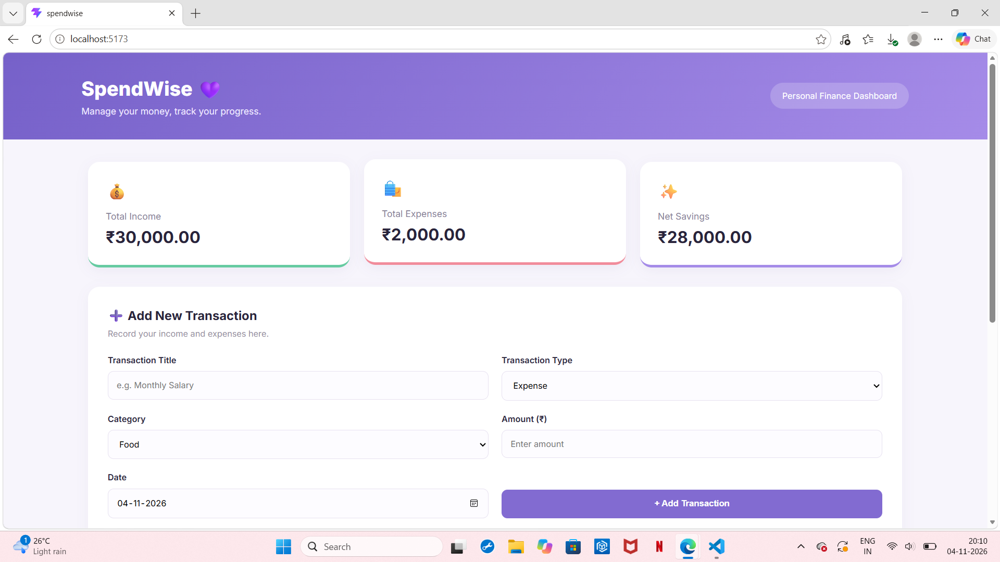
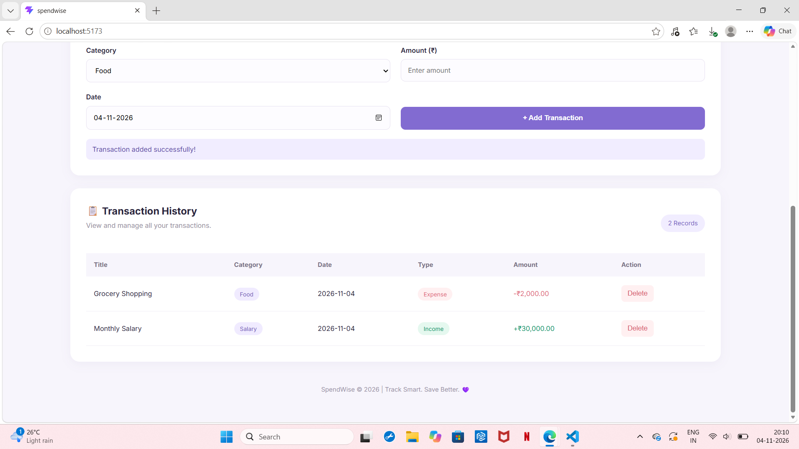
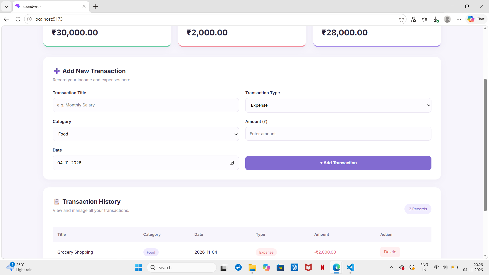
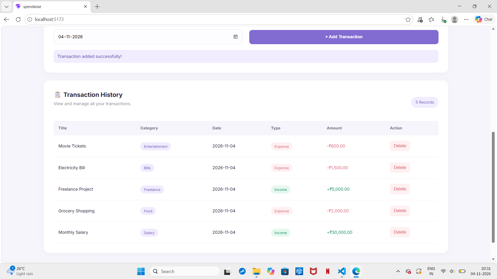
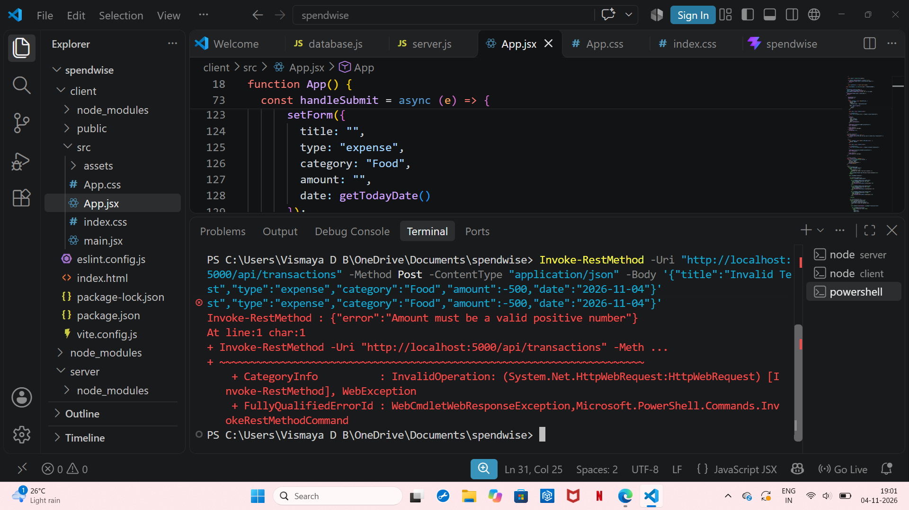
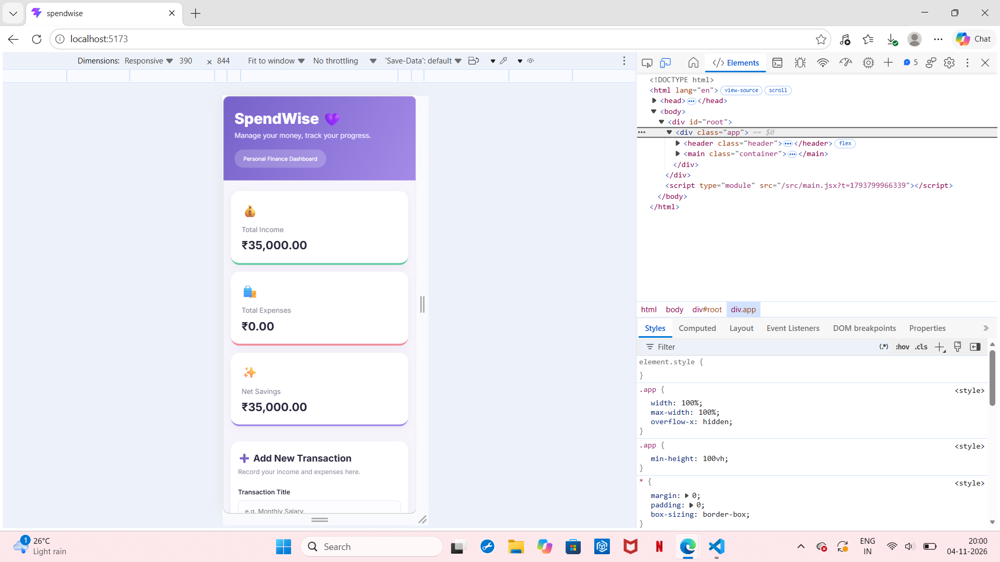
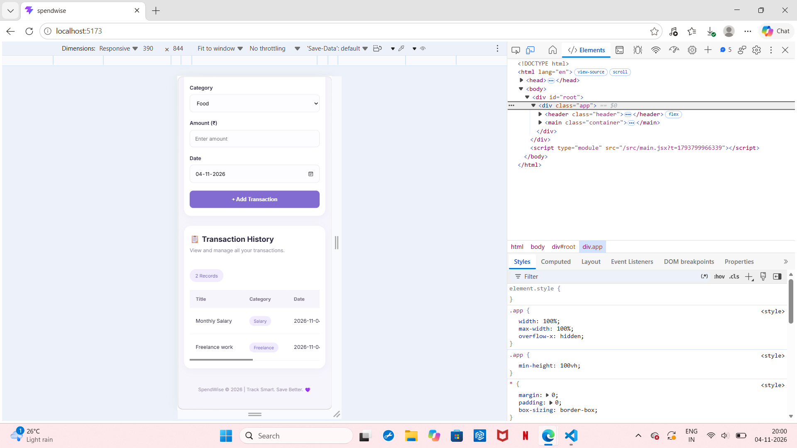

# SpendWise – Full Stack Expense Tracker

## 1. Project Overview

SpendWise is a full-stack expense tracking application developed as part of the CodeNova Full Stack Development Internship – Task 2.

The application allows users to record income and expenses, organize transactions by category, monitor their financial activity, and view automatically calculated financial summaries.

It provides a responsive dashboard with persistent database storage, transaction validation, and an interactive transaction history.

## 2. Features

- **Add Transactions:** Record income and expenses with a title, category, amount, type, and date.
- **Transaction Categories:** Organize transactions using categories.
- **Income Summary:** Dynamically displays total income.
- **Expense Summary:** Dynamically displays total expenses.
- **Net Savings:** Calculates the difference between total income and expenses.
- **Transaction History:** Displays recorded transactions in a table.
- **Category Badges:** Visually distinguishes transaction categories and types.
- **Delete Transactions:** Remove unwanted transaction records.
- **Client-side Validation:** Checks user input before submitting transactions.
- **Server-side Validation:** Independently validates transaction details, including amounts and dates.
- **Database Persistence:** Stores transaction records in SQLite so they remain available after server restarts.
- **Responsive Interface:** Adapts the dashboard to desktop and mobile screens.

## 3. Technology Stack

| Component | Technology |
|---|---|
| Frontend | React.js |
| Build Tool | Vite |
| Styling | CSS |
| Backend | Node.js |
| Backend Framework | Express.js |
| Database | SQLite |
| Database Library | better-sqlite3 |
| API Communication | REST API |
| Development Environment | Visual Studio Code |

## 4. Project Architecture

The application follows a client-server architecture.

- **Client:** Provides the user interface, transaction form, summary cards, and transaction history.
- **Server:** Handles API requests, validates transaction data, and communicates with the database.
- **Database:** Stores transaction records persistently using SQLite.

### Folder Structure

```text
spendwise/
│
├── client/
│   ├── public/
│   ├── src/
│   │   ├── App.jsx
│   │   ├── App.css
│   │   ├── index.css
│   │   └── main.jsx
│   ├── index.html
│   ├── package.json
│   └── vite.config.js
│
├── server/
│   ├── database.js
│   ├── server.js
│   ├── package.json
│   └── transactions.db (generated automatically)
│
├── screenshots/
│
├── .gitignore
└── README.md
```

The `transactions.db` file is generated automatically when the backend starts for the first time. It is excluded from Git.

## 5. Installation and Setup

### Prerequisites

Install the following before running the application:

- Node.js
- npm
- Visual Studio Code
- A modern web browser

### Step 1: Clone the Repository

```bash
git clone YOUR_GITHUB_REPOSITORY_URL
cd spendwise
```

Replace `YOUR_GITHUB_REPOSITORY_URL` with the actual repository URL.

### Step 2: Install Backend Dependencies

Open a terminal in the project directory and execute:

```bash
cd server
npm install
```

### Step 3: Start the Backend Server

```bash
node server.js
```

The backend runs at:

```text
http://localhost:5000
```

Expected terminal messages:

```text
SQLite database connected successfully!
SpendWise server running at http://localhost:5000
```

### Step 4: Install Frontend Dependencies

Open a second terminal in the project directory and execute:

```bash
cd client
npm install
```

### Step 5: Start the Frontend

```bash
npm run dev
```

Open the frontend in your browser:

```text
http://localhost:5173
```

**Important:** Keep both the frontend and backend terminals running while using the application.

## 6. API Documentation

The backend exposes REST API endpoints for transaction management and financial summaries.

Base URL:

```text
http://localhost:5000
```

### 6.1 Get All Transactions

**Endpoint:** `GET /api/transactions`

Retrieves all stored transactions, ordered by date and ID.

### 6.2 Add a Transaction

**Endpoint:** `POST /api/transactions`

Adds a new income or expense transaction.

Request body:

```json
{
  "title": "Monthly Salary",
  "type": "income",
  "category": "Salary",
  "amount": 30000,
  "date": "2026-11-04"
}
```

Validation includes:

- Required title, category, type, amount, and date.
- Transaction type must be either `income` or `expense`.
- Amount must be a valid positive number.
- Date must be a valid calendar date.

A successful request returns the newly created transaction with HTTP status `201`.

Invalid input is rejected by the backend.

### 6.3 Delete a Transaction

**Endpoint:** `DELETE /api/transactions/:id`

Deletes a transaction using its unique ID.

The server returns an error if the supplied ID is invalid or the transaction does not exist.

### 6.4 Get Financial Summary

**Endpoint:** `GET /api/summary`

Returns the calculated financial summary.

Example response:

```json
{
  "totalIncome": 30000,
  "totalExpenses": 2000,
  "netSavings": 28000
}
```

The values are calculated from the stored database records.

## 7. Database Model

SpendWise uses SQLite for persistent storage.

The database file is named:

```text
transactions.db
```

### Transactions Table

| Column | Data Type | Description |
|---|---|---|
| id | INTEGER | Primary key, auto-incremented |
| title | TEXT | Transaction title |
| type | TEXT | Income or expense |
| category | TEXT | Transaction category |
| amount | REAL | Transaction amount, greater than zero |
| date | TEXT | Transaction date |
| created_at | TEXT | Record creation timestamp |

### Database Constraints

- `id` is the primary key.
- `title`, `type`, `category`, and `date` are required.
- `type` accepts only `income` or `expense`.
- `amount` must be greater than zero.
- `created_at` uses the database's default current timestamp.

The database table is created automatically by `database.js` if it does not already exist.

## 8. Financial Calculations

The dashboard calculates its financial summaries using the stored transaction records.

**Total Income**

Sum of all transactions with type `income`.

**Total Expenses**

Sum of all transactions with type `expense`.

**Net Savings**

```text
Net Savings = Total Income - Total Expenses
```

The summary API calculates these values from the database, ensuring the dashboard reflects the stored records.

## 9. Validation and Error Handling

The application implements two layers of validation.

**Client-side validation**
- Checks required fields.
- Checks that the amount is positive.
- Checks date validity before submitting the form.

**Server-side validation**
- Independently checks transaction fields.
- Rejects invalid transaction types.
- Rejects zero, negative, or invalid amounts.
- Rejects invalid calendar dates.
- Returns appropriate error responses for invalid requests.

This ensures invalid data cannot be added merely by bypassing the frontend form.

## 10. Testing and Verification

The following application behaviours were tested:

- Adding income transactions.
- Adding expense transactions.
- Displaying transaction history.
- Deleting transactions.
- Updating dashboard summaries after transactions are added or deleted.
- Rejecting invalid transaction amounts through the backend.
- Rejecting invalid dates through the backend.
- Preserving transaction records after restarting the backend server.
- Checking the mobile-responsive layout.

## 11. Screenshots and Demonstration

Application screenshots and local walkthrough evidence are included in the `screenshots/` folder.

The screenshots demonstrate:

1. Main SpendWise dashboard.
2. Transaction entry form.
3. Transaction history with category badges.
4. Income, expense, and net savings summary cards.
5. Mobile-responsive dashboard.
6. Validation and application behaviour, where applicable.

### Dashboard View 1


### Dashboard View 2


### Transaction Form


### Transaction History


### Server-side Amount Validation


### Server-side Date Validation


### Mobile Responsive View 1


### Mobile Responsive View 2


## 12. CodeNova Internship Task

**Program:** CodeNova Full Stack Development Internship  
**Task:** Task 2 – Expense Tracker  
**Project:** SpendWise  
**Category:** Full Stack Development

The project demonstrates frontend and backend integration, REST API development, database persistence, validation, financial calculations, and responsive user interface design.

---

**Author:** Vismaya D B

**GitHub Repository:** [Add your repository link after uploading the project]
